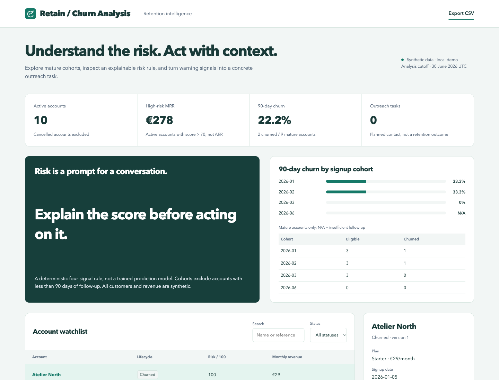

# Retain / Churn Analysis

A reproducible synthetic SaaS retention analysis with mature-cohort reporting, a transparent risk rule and persistent outreach planning.

[](https://github.com/phlppgdfry/customer-churn-analysis/actions/workflows/demo.yml)



## Run it in one command

Requires Python 3.11+ with SQLite support. No pip install, account, API key or Node runtime is needed to run the application.

```bash
git clone https://github.com/phlppgdfry/customer-churn-analysis.git
cd customer-churn-analysis
python3 -m demo.server
```

Open **http://127.0.0.1:8114**. The first start seeds `var/demo.sqlite3`; later starts preserve changes. The server binds to loopback only.

Use a new database path for a fresh workspace, without overwriting existing work:

```bash
python3 -m demo.server --port 8214 --db var/fresh-demo.sqlite3
```

## Try the complete workflow

1. Review the cohort panel: nine mature accounts and two cancellations within 90 days produce 22.2% 90-day churn. June is N/A.
2. Select Canal Digital and inspect the four risk contributions. Create an outreach task with a fictional conversation brief.
3. Reload and verify the task persists. Risk and churn metrics remain unchanged: planned contact is not a measured retention outcome.

Search and status filtering, record inspection, CSV export, input errors, an activity log, responsive layouts, individual SVG branding, favicons and Apple touch icons are included.

## Why this project exists

A retention team needs reproducible churn denominators and explainable account signals before deciding which customers to contact.

The implementation completes one demonstrable product slice, with explicit business rules and verifiable state changes. This is a **local portfolio demonstration with synthetic data**, not an operating service or evidence of client outcomes.

## Business rules

- Analysis cutoff = 30 June 2026 UTC. Only accounts with at least 90 elapsed days since signup enter the denominator.
- A mature account is a 90-day churner when its cancellation date is ≤90 days after signup. A later cancellation is not a 90-day event.
- Risk = 35 points for login drop >50%, 25 for no invitations, 20 for no project and 20 for support unanswered >24h. High risk is strictly >70.
- High-risk MRR sums monthly subscription amounts of active accounts scoring >70. Cancelled accounts are excluded. No MRR/ARR conversion or realised savings is implied.

## Verify and reproduce

```bash
make check                 # domain, HTTP, transaction and concurrency tests + syntax checks
make report                # deterministic baseline JSON and CSV; does not modify the database
```

Node 24+ is used only for JavaScript syntax checks and browser verification. The browser suite has a pinned development dependency:

```bash
npm ci
npx playwright install chromium
npm run test:e2e
```

The six Chromium tests start an isolated Python server and temporary database, then clean it up. They cover branding/assets, filtering, 390/768/1440 px widths and the complete domain workflow. GitHub Actions also runs Python tests on 3.11 and 3.14. See [validation evidence](docs/validation.md).

Baseline evidence is committed in [reports/baseline/snapshot.json](reports/baseline/snapshot.json) and [records.csv](reports/baseline/records.csv). These are generated from the fixtures, not a screenshot of arbitrary runtime state.

## Engineering decisions

**Label the method honestly.** The scorer is a deterministic rule, not logistic regression, calibrated probability or a validated predictive model.

**Handle right censoring.** Customers with insufficient follow-up are excluded rather than counted as retained; cohort N/A is different from zero churn.

**Separate intervention from outcome.** An outreach task changes workflow state only. It does not lower risk, mark a customer saved, send a message or invent financial impact.

The browser uses semantic HTML, native JavaScript modules and CSS. The Python application separates input contracts, domain rules, transactional persistence and HTTP transport. Records use optimistic version checks; each mutation and its audit entry commit together. Rejected actions leave both unchanged.

## Scope and evidence

All 12 accounts, feature signals and monetary amounts are synthetic. No Stripe, HubSpot, Mixpanel or survey data was accessed. The original −40% churn reduction, €240k impact and customer research are unverified concept assumptions, not outcomes.

The June concept is retained in [original-concept.md](docs/original-concept.md), explicitly labelled as unverified history. Current functionality is defined by the source, tests and this README. The demo has no authentication or tenant boundaries; use fictional data and keep it local.

## Explore the repository

| Resource | Purpose |
| --- | --- |
| [demo/domain.py](demo/domain.py) | Fixtures, calculations and use cases |
| [demo/store.py](demo/store.py) | SQLite transactions, optimistic versions and audit log |
| [demo/web/feature.js](demo/web/feature.js) | Domain-specific forms and details |
| [tests](tests) | Domain, persistence, HTTP and browser verification |
| [Architecture](docs/architecture.md) | Boundaries, tradeoffs and data flow |
| [API contract](docs/api.md) | Routes, payloads and errors |
| [Case study](docs/case-study.md) | Problem, acceptance criteria and delivery scope |
| [Runbook](docs/runbook.md) | Start, inspect, export and recover |
| [Mobile preview](docs/mobile.png) | 390 px workspace |

Built by [Philippe Godfroy](https://github.com/phlppgdfry).
